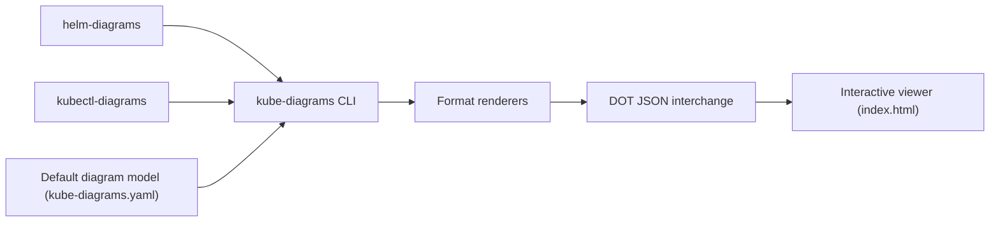

# philippemerle/KubeDiagrams

> Generates Kubernetes architecture diagrams from manifests, Helm, Kustomize or the state of a cluster.

## The problem
Understanding or documenting a Kubernetes application by reading dozens of YAML files.

## What it actually does
`kube-diagrams` reads normalized Kubernetes YAML (via kubectl, Kustomize, Helm, Helmfile upstream) and draws nodes, clusters by namespace or label, and typed links. 51 native resource types, CRDs via configuration files. Outputs: D2, DOT, draw.io, Mermaid, PNG, SVG, PDF. An interactive viewer and a web application are included.

## How it is wired


## Trying it
```bash
pip install KubeDiagrams
kube-diagrams -o cassandra.png examples/cassandra/cassandra.yml
kubectl get all -o yaml | kube-diagrams -o default-namespace.png -
helm-diagrams https://charts.jetstack.io/cert-manager -o diagram.png
```

## Cost and gotchas
Free; requires Python 3.9+ and Graphviz (`dot`). `helm-diagrams` requires `helm`. Windows: only the container image is supported.

## What it is not
Not a monitoring tool: it draws what you give it, it does not connect to the cluster on its own. 12 native resources are not handled.

## Alternatives
The README points to a tool comparison, without naming any in the text.

## For you
Adopt if you deploy AI or data workloads on Kubernetes: output usable in documentation, simple installation, Apache-2.0 license.
