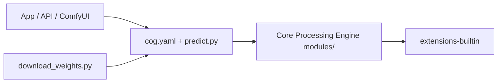

# philz1337x/clarity-upscaler

> AI image upscaler and enhancer, open version of a paid offering, via Cog, ComfyUI or A1111.

## The problem
Enlarging images by adding plausible detail, without going through a paid service.

## What it actually does
The repository is an implementation for Cog, derived from the A1111 base (processing modules, LDSR, Lora, ScuNET, SwinIR extensions). It also offers a free workflow for ComfyUI and A1111 settings. The ClarityAI.co app, its API and the ComfyUI node are paid. The Flux version is not open source.

## How it is wired


## Trying it
```bash
python download_weights.py
cog predict -i image="link-to-image"
```

## Cost and gotchas
A GPU to run locally. The simple option is the paid app. AGPL-3.0 license. Last push in March 2025.

## What it is not
Not the author's most recent version: Flux upscaling is closed. The README recommends simpler options than Cog.

## Alternatives
- ComfyUI (free workflow) and A1111: recommended by the README to avoid Cog.

## For you
Ignore: an image-processing tool with no strong link to your field, funded by a paid offering, not updated since March 2025.
