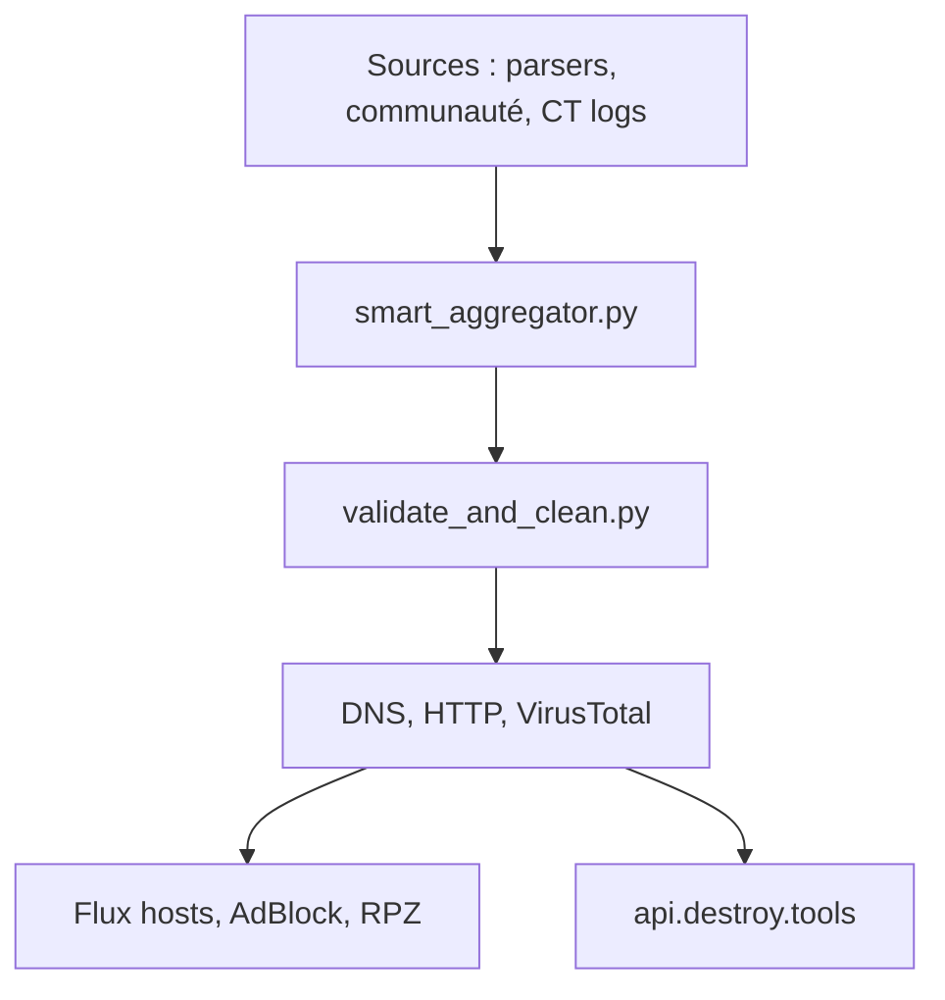

# phishdestroy/destroylist

> Blocklist of phishing and scam domains, with feeds, DNS formats and a free API.

## The problem
Blocking phishing domains at the DNS level requires fresh, verified lists in the right format.

## What it actually does
Publishes Primary (curated) and Community (aggregated from more than 13 sources) feeds, with variants verified by DNS or HTTP content, in hosts, AdBlock, dnsmasq, Unbound, RPZ and Redis formats. A risk score API (0-100) with no key, with per-IP limits. Full history in the commits.

## How it is wired


## Trying it
```bash
curl -fsSL https://raw.githubusercontent.com/phishdestroy/destroylist/main/rootlist/formats/primary_active/hosts.txt -o hosts_blocklist.txt
curl "https://api.destroy.tools/v1/check?domain=suspicious-site.xyz"
```

## Cost and gotchas
Free, no key. The API has quotas (300 units/min), 429 errors are possible on raw GitHub: prefer the jsDelivr CDN. False positives are possible, with appeal through a form.

## What it is not
Not a security guarantee: a domain that is absent is not safe (cloaking). Not an antivirus.

## Alternatives
No alternative named in the README.

## For you
Adopt: a ready-made list to plug into Pi-hole or AdGuard to protect a homelab, at the cost of one line of configuration.
