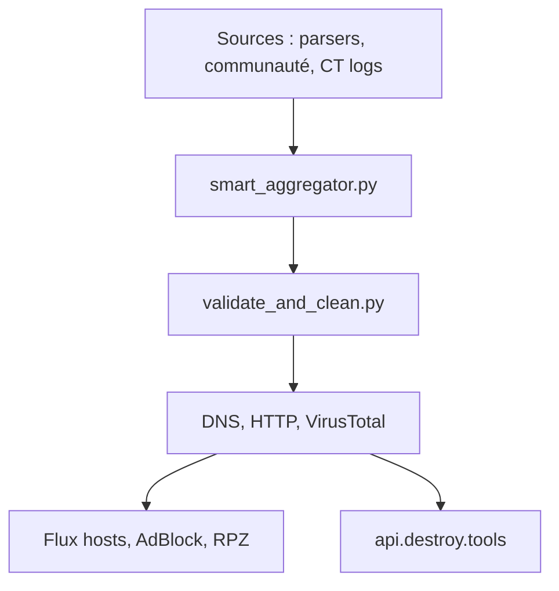

# phishdestroy/destroylist

> Liste de blocage de domaines de phishing et d'arnaques, avec flux, formats DNS et API gratuite.

## Le problème
Bloquer les domaines de phishing au niveau DNS demande des listes fraîches, vérifiées et dans le bon format.

## Ce que ça fait vraiment
Publie des flux Primary (curés) et Community (agrégés de plus de 13 sources), avec variantes vérifiées en DNS ou en contenu HTTP, aux formats hosts, AdBlock, dnsmasq, Unbound, RPZ et Redis. Une API de score de risque (0-100) sans clé, avec limites par IP. Historique complet dans les commits.

## Comment c'est branché


## Essayer
```bash
curl -fsSL https://raw.githubusercontent.com/phishdestroy/destroylist/main/rootlist/formats/primary_active/hosts.txt -o hosts_blocklist.txt
curl "https://api.destroy.tools/v1/check?domain=suspicious-site.xyz"
```

## Coût et pièges
Gratuit, sans clé. L'API a des quotas (300 unités/min), 429 possibles sur GitHub brut : préférer le CDN jsDelivr. Faux positifs possibles, recours via formulaire.

## Ce que ce n'est pas
Pas une garantie de sécurité : un domaine absent n'est pas sûr (cloaking). Pas un antivirus.

## Alternatives
Aucune alternative nommée dans le README.

## Pour toi
Adopter : une liste prête à brancher sur Pi-hole ou AdGuard pour protéger un homelab, au coût d'une ligne de configuration.

