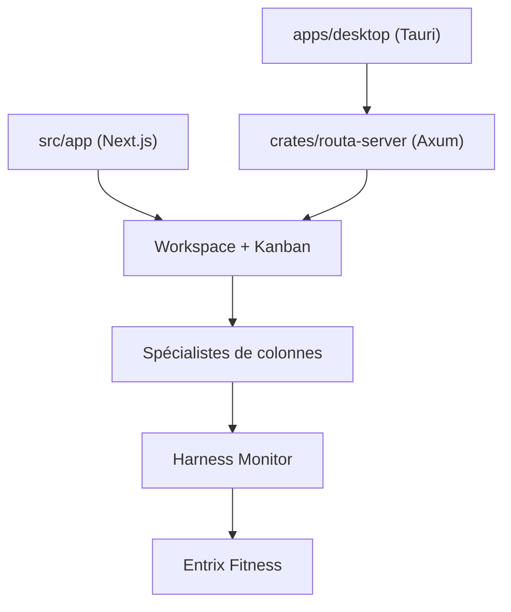

# phodal/routa

> Multi-agent coordination platform on a Kanban board, for shipping software with evidence and review.

## The problem
In a single chat, decomposition, code, review and the delivery decision get mixed together, with no verifiable trace or evidence.

## What it actually does
One Kanban board per workspace: each column (Backlog, Todo, Dev, Review, Done, Blocked) applies a specialist prompt and an evidence contract. Cards accumulate a YAML story, a plan, evidence and a verdict. It runs on the web (Next.js) or on the desktop (Tauri, Axum backend) and opens up to the ACP, MCP, A2A, REST and SSE protocols.

## How it is wired
Simplified diagram based on the sheet, no diagram provided.



## Trying it
```bash
npm install -g routa-cli
routa --help
routa -p "Explain the architecture of this repository"
npm install --legacy-peer-deps
npm run dev
```

## Cost and gotchas
You must enable an agent provider: the calls are at your expense. The web installation requires `--legacy-peer-deps`.

## What it is not
It is not an autonomous coding agent: it orchestrates third-party agents. The repository, from February 2026, is still young.

## Alternatives
No alternative named in the README.

## For you
Worth watching: the idea of lanes with evidence and independent review is solid for industrializing agents, but the tool is young and maintained by a single person.
