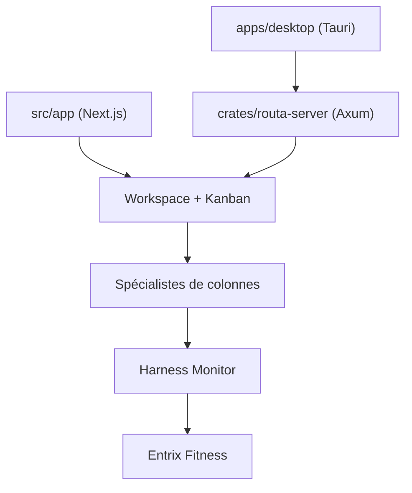

# phodal/routa

> Plateforme de coordination multi-agents sur tableau Kanban, pour livrer du logiciel avec preuves et revue.

## Le problème
Dans un chat unique, la décomposition, le code, la revue et la décision de livraison se mélangent, sans trace ni preuve vérifiable.

## Ce que ça fait vraiment
Un tableau Kanban par espace de travail : chaque colonne (Backlog, Todo, Dev, Review, Done, Blocked) applique un prompt de spécialiste et un contrat de preuves. Les cartes accumulent histoire YAML, plan, preuves, verdict. Il tourne en web (Next.js) ou en bureau (Tauri, backend Axum) et s'ouvre aux protocoles ACP, MCP, A2A, REST et SSE.

## Comment c'est branché
Schéma simplifié d'après la fiche, sans diagramme fourni.



## Essayer
```bash
npm install -g routa-cli
routa --help
routa -p "Explain the architecture of this repository"
npm install --legacy-peer-deps
npm run dev
```

## Coût et pièges
Il faut activer un fournisseur d'agent : les appels sont à ta charge. L'installation web demande `--legacy-peer-deps`.

## Ce que ce n'est pas
Ce n'est pas un agent de code autonome : il orchestre des agents tiers. Le dépôt, de février 2026, est encore jeune.

## Alternatives
Aucune alternative nommée dans le README.

## Pour toi
À surveiller : l'idée de lanes avec preuves et revue indépendante est solide pour industrialiser des agents, mais l'outil est jeune et tenu par une seule personne.

