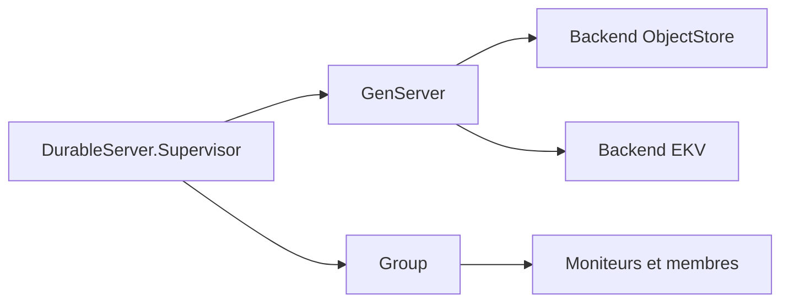

# phoenixframework/durable_server

> Elixir library of distributed GenServers whose state is persisted to object storage or EKV.

## The problem
A stateful process disappears on a node failure or a deployment, and its state is lost.

## What it actually does
Saves GenServer state to storage (S3-compatible object storage, EKV or a dual migration) and restarts them elsewhere in the cluster. Handles load-based placement, an administrative "cordon", manual or periodic synchronization, and a Group module for discovery and message broadcasting.

## How it is wired


## Trying it
```bash
docker run -d --name localstack -p 4566:4566 localstack/localstack
mix test
mix test --include integration
```

## Cost and gotchas
Elixir, `:os_mon` for releases, and S3 storage (or EKV with cluster_size). Integration tests target Tigris, with keys supplied by you. Version 0.1.x announced.

## What it is not
Not a database or a message queue. A call timeout does not cancel a storage write already started.

## Alternatives
No alternative named in the README.

## For you
Watch only if you build stateful Elixir services; no direct link with data / AI pipelines.
