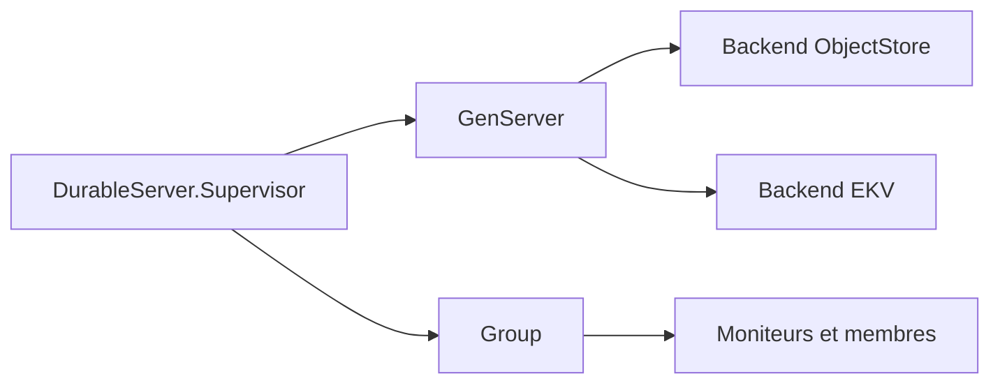

# phoenixframework/durable_server

> Bibliothèque Elixir de GenServers distribués dont l'état est persisté sur stockage objet ou EKV.

## Le problème
Un processus avec état disparaît lors d'une panne de nœud ou d'un déploiement, et son état est perdu.

## Ce que ça fait vraiment
Sauvegarde l'état des GenServers vers un stockage (objet compatible S3, EKV ou une migration double) et les redémarre ailleurs dans le cluster. Gère le placement selon la charge, un « cordon » administratif, une synchronisation manuelle ou périodique, et un module Group pour la découverte et la diffusion de messages.

## Comment c'est branché


## Essayer
```bash
docker run -d --name localstack -p 4566:4566 localstack/localstack
mix test
mix test --include integration
```

## Coût et pièges
Elixir, `:os_mon` pour les releases, et un stockage S3 (ou EKV avec cluster_size). Les tests d'intégration visent Tigris, avec clés à ta charge. Version 0.1.x annoncée.

## Ce que ce n'est pas
Pas une base de données ni une file de messages. Un timeout d'appel ne coupe pas l'écriture de stockage déjà lancée.

## Alternatives
Aucune alternative nommée dans le README.

## Pour toi
À surveiller seulement si tu construis des services Elixir à état ; aucun lien direct avec les pipelines data / IA.

