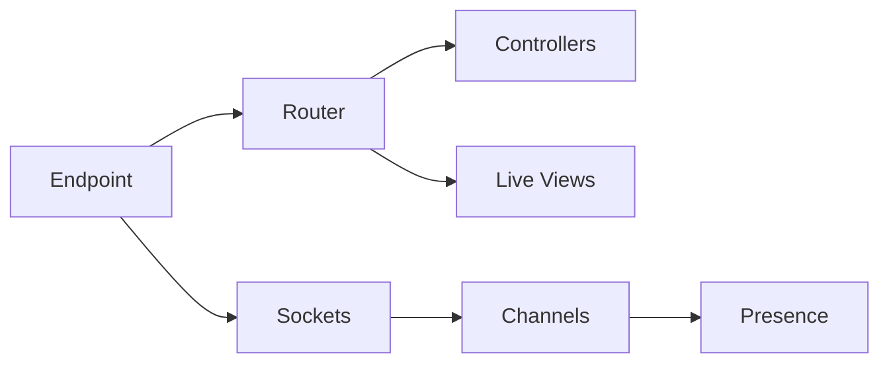

# phoenixframework/phoenix

> Elixir web framework, from prototype to production, with real time through channels and WebSocket.

## The problem
Building a web app with real time (channels, presence) takes a lot of assembly without a coherent framework.

## What it actually does
An Endpoint receives HTTP/WebSocket, a Router dispatches to controllers or channels. The code also describes Live Views, Presence, tokens, telemetry, code reloading and Mix tasks. The README itself defers almost everything to the official website.

## How it is wired


## Trying it
```bash
cd phoenix/installer
mix phx.new dev_app --dev
```
(Generates a project pointing to your local clone of Phoenix.)

## Cost and gotchas
Free. The README does not detail the stable installation: it points to the official website (not documented here).

## What it is not
Not a data/AI tool. This repository is the framework's code; normal usage goes through the published installer, not this clone.

## Alternatives
None named in the README.

## For you
Ignore: solid Elixir framework, but unrelated to a Python data / AI / MLOps daily routine.
