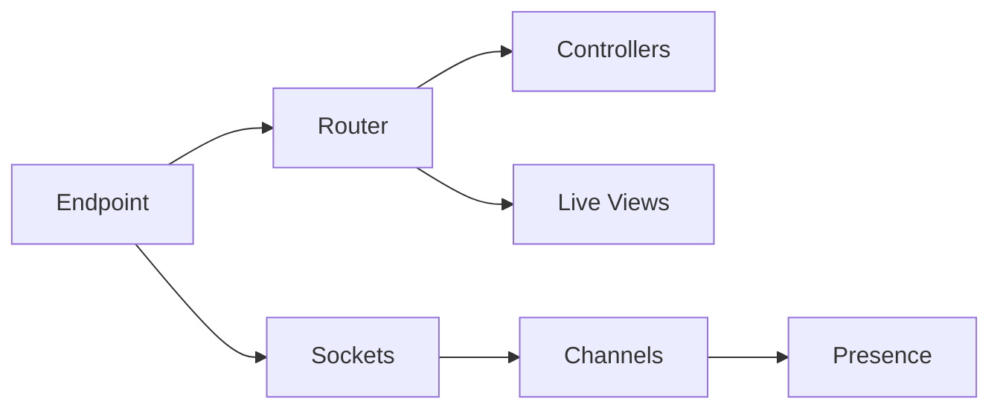

# phoenixframework/phoenix

> Framework web Elixir, du prototype à la production, avec temps réel via canaux et WebSocket.

## Le problème
Construire une appli web avec temps réel (canaux, présence) demande beaucoup d'assemblage sans framework cohérent.

## Ce que ça fait vraiment
Un Endpoint reçoit HTTP/WebSocket, un Router dispatche vers des contrôleurs ou des canaux. Le code décrit aussi Live Views, Presence, tokens, télémétrie, rechargement de code et tâches Mix. Le README lui-même renvoie presque tout au site officiel.

## Comment c'est branché


## Essayer
```bash
cd phoenix/installer
mix phx.new dev_app --dev
```
(Génère un projet pointant vers ton clone local de Phoenix.)

## Coût et pièges
Gratuit. Le README ne détaille pas l'installation stable : il renvoie au site officiel (non documenté ici).

## Ce que ce n'est pas
Pas un outil data/IA. Ce dépôt est le code du framework ; l'usage normal passe par l'installateur publié, pas par ce clone.

## Alternatives
Aucune nommée dans le README.

## Pour toi
Ignorer : framework Elixir solide, mais sans lien avec un quotidien data / IA / MLOps en Python.

