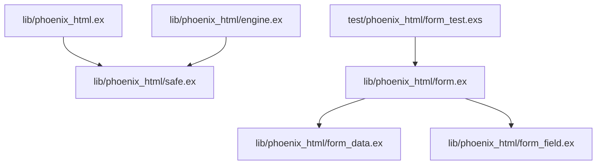

# phoenixframework/phoenix_html

> HTML building blocks for the Phoenix (Elixir) web framework: escaping, forms and a small piece of JavaScript.

## The problem
Generating server-side HTML without injection flaws and without hand-writing form fields again and again.

## What it actually does
Provides HTML safety (escaping via `safe.ex`), the template engine (`engine.ex`), form abstractions (`form.ex`, `form_data.ex`, `form_field.ex`) and a tiny JavaScript library. The README defers to the documentation for details.

## How it is wired


## Trying it
```bash
# Aucune commande documentée dans le README : voir la documentation du projet.
```

## Cost and gotchas
Free. Requires an Elixir/Phoenix project (Elixir is not in the prerequisites list, hence `none`). Consumed as a Mix dependency, not as a standalone tool.

## What it is not
Not a web framework: it is a dependency of Phoenix. No direct data or AI use.

## Alternatives
No alternative named in the README.

## For you
Ignore: Elixir HTML rendering building block, outside your data / AI / MLOps scope, unless you write a Phoenix interface.
