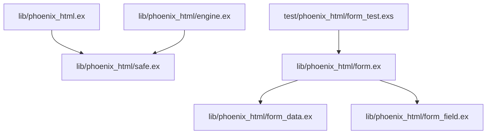

# phoenixframework/phoenix_html

> Briques HTML pour le framework web Phoenix (Elixir) : échappement, formulaires et un petit JavaScript.

## Le problème
Générer du HTML côté serveur sans faille d'injection et sans réécrire à la main les champs de formulaire.

## Ce que ça fait vraiment
Fournit la sûreté HTML (échappement via `safe.ex`), le moteur de templates (`engine.ex`), des abstractions de formulaire (`form.ex`, `form_data.ex`, `form_field.ex`) et une minuscule bibliothèque JavaScript. Le README renvoie à la documentation pour le détail.

## Comment c'est branché


## Essayer
```bash
# Aucune commande documentée dans le README : voir la documentation du projet.
```

## Coût et pièges
Gratuit. Nécessite un projet Elixir/Phoenix (Elixir n'est pas dans la liste des prérequis, d'où `aucun`). Se consomme comme dépendance Mix, pas comme outil autonome.

## Ce que ce n'est pas
Pas un framework web : c'est une dépendance de Phoenix. Aucun usage data ou IA direct.

## Alternatives
Aucune alternative nommée dans le README.

## Pour toi
Ignorer : brique de rendu HTML Elixir, hors de ton périmètre data / IA / MLOps, sauf si tu écris une interface Phoenix.

