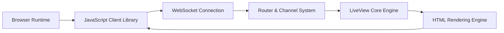

# phoenixframework/phoenix_live_view

> Elixir library for real-time, server-rendered interfaces, for Phoenix developers.

## The problem
Building rich interfaces requires synchronizing client and server with a lot of JavaScript.

## What it actually does
HTML rendering is done on the server; after the first display, a persistent connection (WebSocket, long polling fallback) sends only the diffs. HEEx templates, components, live-validated forms, file uploads with progress, JS commands, built-in testing. Shipped by default in new Phoenix projects.

## How it is wired


## Trying it
```bash
mix archive.install hex phx_new
mix phx.new demo
```

## Cost and gotchas
Requires Elixir installed. README truncated in the middle: end of the document is about tests (npm run js:test.watch, e2e:test).

## What it is not
Not a standalone framework: it relies on Phoenix and Elixir.

## Alternatives
No alternative named in the README (community component systems are listed).

## For you
Ignore: unless your team already writes Elixir, no use for data/AI/MLOps.
