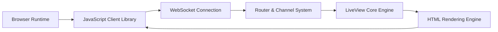

# phoenixframework/phoenix_live_view

> Bibliothèque Elixir pour des interfaces temps réel rendues côté serveur, pour développeurs Phoenix.

## Le problème
Construire des interfaces riches impose de synchroniser client et serveur avec beaucoup de JavaScript.

## Ce que ça fait vraiment
Le rendu HTML est fait sur le serveur ; après le premier affichage, une connexion persistante (WebSocket, repli long polling) envoie seulement les différences. Templates HEEx, composants, formulaires validés en direct, envoi de fichiers avec progression, commandes JS, tests intégrés. Livré par défaut dans les nouveaux projets Phoenix.

## Comment c'est branché


## Essayer
```bash
mix archive.install hex phx_new
mix phx.new demo
```

## Coût et pièges
Demande Elixir installé. README tronqué au milieu : fin de document sur les tests (npm run js:test.watch, e2e:test).

## Ce que ce n'est pas
Pas un framework autonome : repose sur Phoenix et Elixir.

## Alternatives
Aucune alternative nommée dans le README (systèmes de composants communautaires listés).

## Pour toi
À ignorer : sauf si ton équipe écrit déjà du Elixir, aucune utilité pour data/IA/MLOps.

