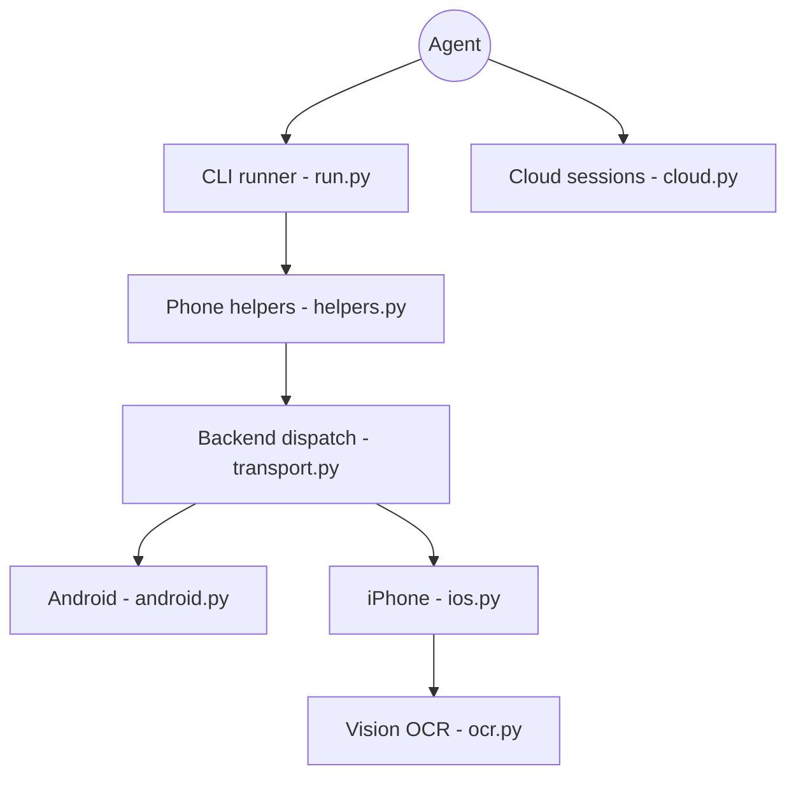

# phone-harness/phone-harness

> CLI that lets an agent control a real Android phone or iPhone, with no jailbreak and no installed app.

## The problem
Coding agents do not act on a real phone: testing an app or automating a mobile flow remains manual.

## What it actually does
The agent runs Python scripts with helpers (`open_app`, `tap_text`, `type_text`, `screen`). On Android: adb and the accessibility tree. On iPhone: capture of the Mac's iPhone Mirroring window, Vision OCR and input events. A cloud offering hosts phones. Hermes, OpenClaw and MCP integrations.

## How it is wired


## Trying it
```bash
phone-harness doctor
phone-harness <<'PY'
open_app("Notes")
tap_text("New Note")
type_text("hello from the harness")
PY
phone-harness cloud login
phone-harness cloud start
phone-harness cloud stop
```

## Cost and gotchas
Android: adb and USB debugging. iPhone: macOS 15+, iPhone Mirroring and Accessibility and Screen Recording permissions. The cloud is paid (iPhone reservation with a 20 dollar deposit per device). Usage telemetry appears in the architecture; its opt-out is documented only for the update check.

## What it is not
No multi-touch, no camera feed or Face ID, DRM video shows black. OCR reads text, not icons: a vision model is needed for unlabeled controls. Connecting the phone remains your job.

## Alternatives
No alternative named in the README.

## For you
Worth watching for agent-driven mobile testing; young project, validate on a real case before building on it.
