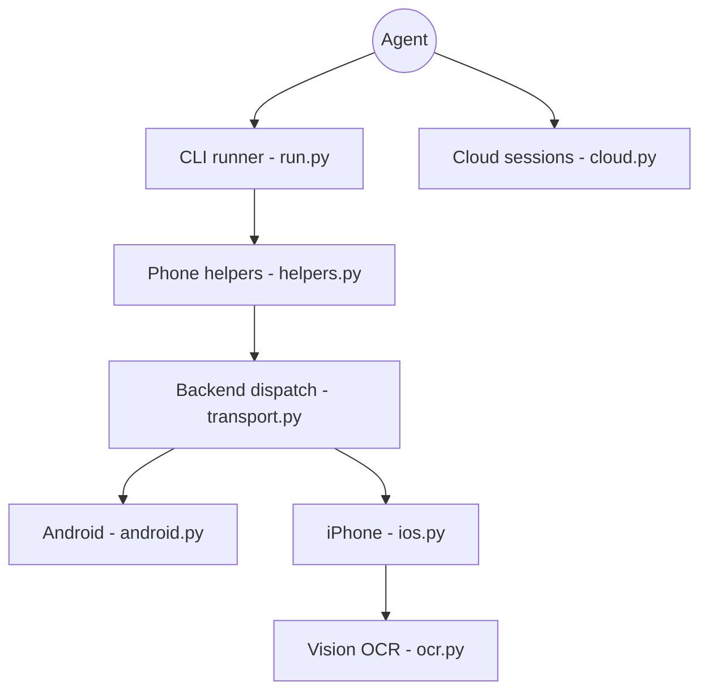

# phone-harness/phone-harness

> CLI qui laisse un agent contrôler un vrai téléphone Android ou iPhone, sans jailbreak ni app installée.

## Le problème
Les agents de code n'agissent pas sur un téléphone réel : tester une app ou automatiser un flux mobile reste manuel.

## Ce que ça fait vraiment
L'agent exécute des scripts Python avec des helpers (`open_app`, `tap_text`, `type_text`, `screen`). Sur Android : adb et l'arbre d'accessibilité. Sur iPhone : capture de la fenêtre iPhone Mirroring du Mac, OCR Vision et événements d'entrée. Une offre cloud héberge des téléphones. Intégrations Hermes, OpenClaw et MCP.

## Comment c'est branché


## Essayer
```bash
phone-harness doctor
phone-harness <<'PY'
open_app("Notes")
tap_text("New Note")
type_text("hello from the harness")
PY
phone-harness cloud login
phone-harness cloud start
phone-harness cloud stop
```

## Coût et pièges
Android : adb et débogage USB. iPhone : macOS 15+, iPhone Mirroring et permissions Accessibilité et Enregistrement d'écran. Le cloud est payant (réservation d'iPhone avec dépôt de 20 dollars par appareil). Une télémétrie d'usage figure dans l'architecture ; son opt-out n'est documenté que pour la vérification de mise à jour.

## Ce que ce n'est pas
Pas multi-touch, pas de flux caméra ni Face ID, vidéo DRM noire. L'OCR lit du texte, pas des icônes : il faut un modèle vision pour les contrôles sans libellé. Connecter le téléphone reste ton travail.

## Alternatives
Aucune alternative nommée dans le README.

## Pour toi
À surveiller pour des tests mobiles pilotés par agent ; jeune projet, à valider sur un cas réel avant de bâtir dessus.

