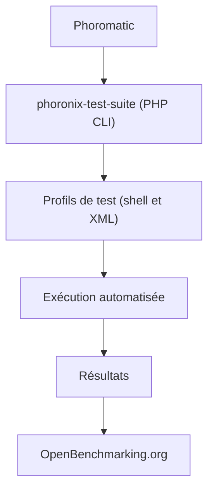

# phoronix-test-suite/phoronix-test-suite

> Automated, reproducible benchmarking framework for Linux and other systems, with more than 600 test profiles.

## The problem
Comparing two machines or two versions of a piece of software requires reproducible measurements, otherwise the numbers cannot be compared.

## What it actually does
Installs, runs and reports tests automatically. A test profile is a set of shell scripts and XML files; a suite is an XML file. Profiles and results are shared on OpenBenchmarking.org. Modules link measurements to git-bisect for per-commit regressions, and Phoromatic drives networked clients.

## How it is wired
Simplified diagram based on the sheet, no diagram provided.


## Trying it
```bash
phoronix-test-suite benchmark smallpt
phoronix-test-suite batch-setup
phoronix-test-suite system-info
phoronix-test-suite benchmark 1204293-BY-PHORONIX357
```

## Cost and gotchas
Free. The only hard dependency: command-line PHP (5.3 or later), not in the prerequisites list. Not all profiles run on all architectures.

## What it is not
Not an AI model evaluation tool: it measures hardware and system software. Phoromatic is enterprise-oriented.

## Alternatives
No alternative cited in the README.

## For you
Watch: useful for comparing machines or GPUs before a purchase or deployment, but with no dedicated AI benchmark in the README.
