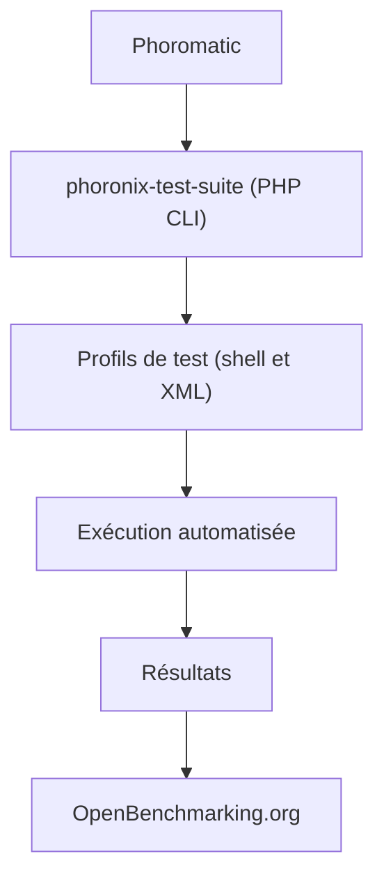

# phoronix-test-suite/phoronix-test-suite

> Cadre de benchmark automatisé et reproductible pour Linux et autres systèmes, avec plus de 600 profils de tests.

## Le problème
Comparer deux machines ou deux versions d'un logiciel exige des mesures reproductibles, sinon les chiffres ne se comparent pas.

## Ce que ça fait vraiment
Installe, exécute et rapporte des tests automatiquement. Un profil de test est un ensemble de scripts shell et de fichiers XML ; une suite est un fichier XML. Les profils et résultats se partagent sur OpenBenchmarking.org. Des modules relient les mesures à git-bisect pour des régressions par commit, et Phoromatic pilote des clients en réseau.

## Comment c'est branché
Schéma simplifié d'après la fiche, sans diagramme fourni.


## Essayer
```bash
phoronix-test-suite benchmark smallpt
phoronix-test-suite batch-setup
phoronix-test-suite system-info
phoronix-test-suite benchmark 1204293-BY-PHORONIX357
```

## Coût et pièges
Gratuit. Seule dépendance dure : PHP en ligne de commande (5.3 ou plus), hors liste de prérequis. Tous les profils ne tournent pas sur toutes les architectures.

## Ce que ce n'est pas
Pas un outil d'évaluation de modèles d'IA : il mesure matériel et logiciels système. Phoromatic est orienté entreprise.

## Alternatives
Aucune alternative citée dans le README.

## Pour toi
Surveiller : utile pour comparer des machines ou des GPU avant un achat ou un déploiement, mais sans benchmark d'IA dédié dans le README.

