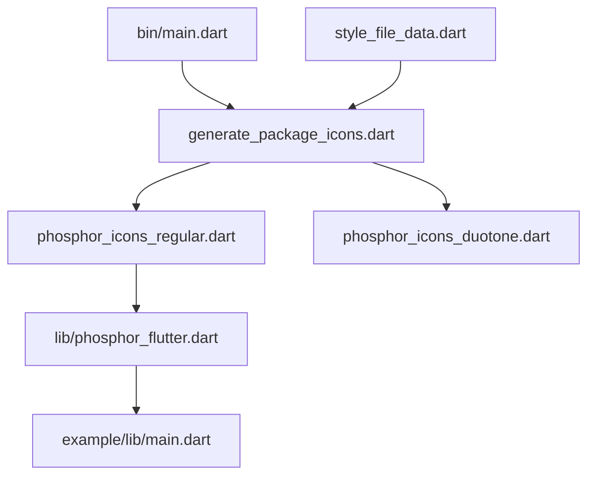

# phosphor-icons/flutter

> Phosphor icon family as IconData classes for Flutter applications.

## The problem
A consistent icon set is needed, in several styles, usable directly in Flutter.

## What it actually does
Provides six styles (regular, thin, light, bold, fill, duotone) via per-style classes and a `PhosphorIcon` widget that handles duotone. Dart scripts generate the classes from the font data. The per-style classes preserve tree shaking.

## How it is wired
Diagram based on the code diagram.



## Trying it
```bash
flutter pub get
cd phosphor_flutter/example
flutter run
```

## Cost and gotchas
Free. `phosphor_flutter: ^any` dependency in `pubspec.yaml`; Flutter required. Migrating from v1 to v2.1 requires changing the syntax.

## What it is not
Not an icon generator: only the existing Phosphor icons. The native `Icon` widget displays duotone as a single tone.

## Alternatives
None cited in the README, which lists the other Phosphor variants (React, Vue, Swift, etc.).

## For you
Ignore: irrelevant for a data / AI / MLOps profile, unless you build a Flutter application.
