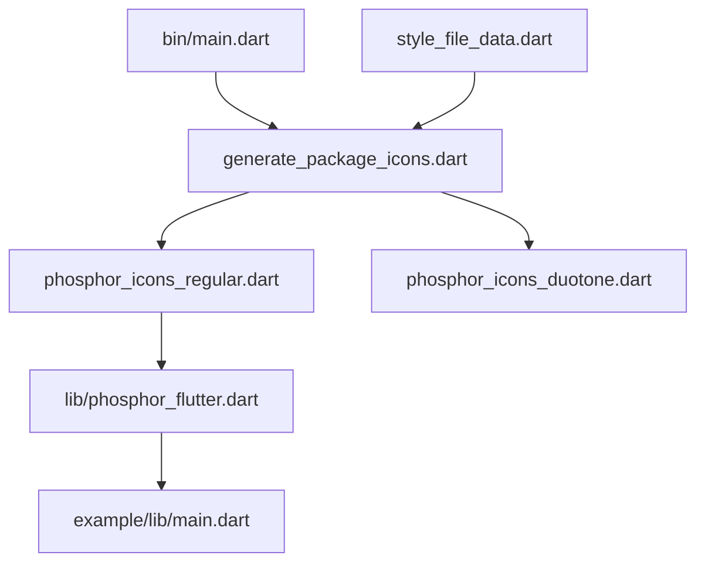

# phosphor-icons/flutter

> Famille d'icônes Phosphor sous forme de classes IconData pour applications Flutter.

## Le problème
Il faut un jeu d'icônes cohérent, en plusieurs styles, utilisable directement dans Flutter.

## Ce que ça fait vraiment
Fournit six styles (regular, thin, light, bold, fill, duotone) via des classes par style et un widget `PhosphorIcon` qui gère le duotone. Des scripts Dart génèrent les classes depuis les données de fonte. Les classes par style préservent le tree shaking.

## Comment c'est branché
Schéma d'après le diagramme du code.



## Essayer
```bash
flutter pub get
cd phosphor_flutter/example
flutter run
```

## Coût et pièges
Gratuit. Dépendance `phosphor_flutter: ^any` dans `pubspec.yaml` ; Flutter requis. Une migration de la v1 à la v2.1 impose de changer la syntaxe.

## Ce que ce n'est pas
Pas un générateur d'icônes : seulement les icônes Phosphor existantes. Le widget `Icon` natif affiche le duotone en simple.

## Alternatives
Aucune citée dans le README, qui liste les autres déclinaisons Phosphor (React, Vue, Swift, etc.).

## Pour toi
Ignorer : sans objet pour un profil data / IA / MLOps, sauf si tu fais une application Flutter.

