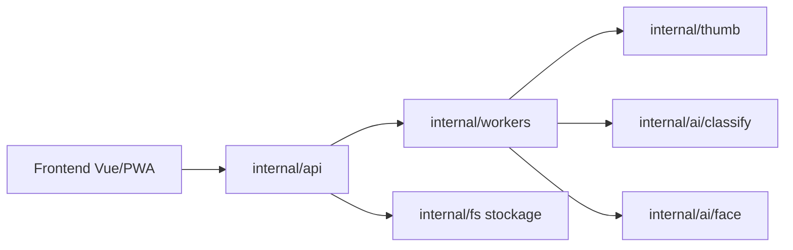

# photoprism/photoprism

> Self-hosted photo application with AI tagging and face recognition, for individuals.

## The problem
Organizing a large photo library without entrusting it to Google, Apple or Amazon.

## What it actually does
Go server + Vue PWA: indexing, thumbnails and transcoding (workers), classification, face detection and NSFW filter via TensorFlow (`internal/ai`), multi-criteria search, maps, Exif/XMP extraction, WebDAV access. MariaDB/MySQL/Postgres databases depending on the provided compose files.

## How it is wired

## Trying it
No command in the README: the Docker installation is deferred to docs.photoprism.app.

## Cost and gotchas
Community edition free; membership or commercial license encouraged, some features potentially reserved (not detailed). License not identified by GitHub, documentation under CC BY-NC-SA.

## What it is not
Not a reusable vision library. GitHub issues are not used for support.

## Alternatives
None named in the README.

## For you
Personal use possible; check the license before any professional use.
