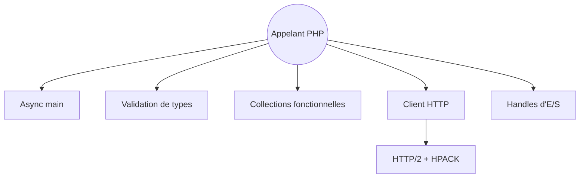

# php-standard-library/php-standard-library

> Typed, asynchronous PHP standard library, for PHP 8.4+ developers who want APIs that fail predictably.

## The problem
PHP's native functions are inconsistent, mix lists and dictionaries, and fail unpredictably. Writing asynchronous code or validating external data takes a lot of glue.

## What it actually does
PSL replaces PHP functions and primitives with centralized, typed APIs: data validation through type combinators, functional collections (`Vec`, `Dict`), structured concurrency on fibers, networking (TCP, TLS, UDP, HTTP, DNS, SMTP), I/O, cryptography and a terminal interface. Typing extensions exist for Mago, Psalm and PHPStan.

## How it is wired


## Trying it
```bash
composer require php-standard-library/php-standard-library
```
PHP 8.4 minimum required.

## Cost and gotchas
Free, MIT license. PHP 8.4+ is mandatory, which rules out many existing projects. The README also indicates that several internal packages were not detailed.

## What it is not
Not a web framework or an application: it is a set of independent packages. Not a data science tool. The port follows the hhvm/hsl style, not compatibility with native PHP functions.

## Alternatives
- hhvm/hsl: the library that inspired PSL, cited in the README.

## For you
Ignore for a data / AI / MLOps profile: it is a general-purpose PHP library, unrelated to Python or model pipelines, useful only if you write PHP.
