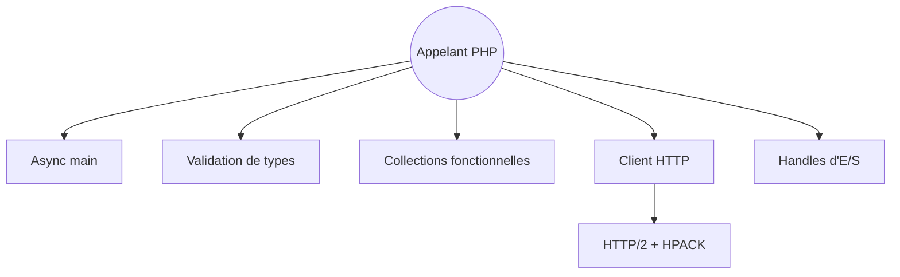

# php-standard-library/php-standard-library

> Bibliothèque standard PHP typée et asynchrone, pour les développeurs PHP 8.4+ qui veulent des API qui échouent de façon prévisible.

## Le problème
Les fonctions natives de PHP sont incohérentes, mélangent listes et dictionnaires, et échouent de manière imprévisible. Écrire du code asynchrone ou valider des données externes demande beaucoup de colle.

## Ce que ça fait vraiment
PSL remplace les fonctions et primitives PHP par des API centralisées et typées : validation de données par combinateurs de types, collections fonctionnelles (`Vec`, `Dict`), concurrence structurée sur fibres, réseau (TCP, TLS, UDP, HTTP, DNS, SMTP), E/S, cryptographie et interface terminal. Des extensions de typage existent pour Mago, Psalm et PHPStan.

## Comment c'est branché


## Essayer
```bash
composer require php-standard-library/php-standard-library
```
PHP 8.4 minimum requis.

## Coût et pièges
Gratuit, licence MIT. PHP 8.4+ obligatoire, ce qui exclut beaucoup de projets existants. Le README indique aussi que plusieurs paquets internes n'ont pas été détaillés.

## Ce que ce n'est pas
Ce n'est pas un framework web ni une application : c'est un ensemble de paquets indépendants. Ce n'est pas un outil de data science. Le portage est de style hhvm/hsl, pas une compatibilité avec les fonctions PHP natives.

## Alternatives
- hhvm/hsl : la bibliothèque qui a inspiré PSL, citée dans le README.

## Pour toi
À ignorer pour un profil data / IA / MLOps : c'est une bibliothèque PHP généraliste, sans rapport avec Python ou les pipelines de modèles, utile seulement si tu écris du PHP.

