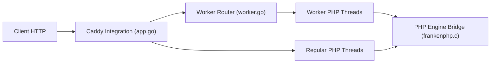

# php/frankenphp

> A PHP application server built on Caddy, for teams deploying Laravel or Symfony.

## The problem
PHP-FPM behind Nginx restarts the application on every request and separates the web server from the interpreter.

## What it actually does
Embeds PHP in Caddy: automatic HTTPS, HTTP/2 and HTTP/3, worker mode (persistent PHP scripts), Early Hints, hot reload. Also usable as a Go library to embed PHP in `net/http`. Available as a binary, rpm/deb/apk packages, Homebrew and Docker.

## How it is wired


## Trying it
```bash
curl https://frankenphp.dev/install.sh | sh
frankenphp php-server
docker run -v .:/app/public -p 80:80 -p 443:443 -p 443:443/udp dunglas/frankenphp
```

## Cost and gotchas
Free. On `https://localhost`, accept the self-signed certificate; `127.0.0.1` does not work.

## What it is not
Not a PHP framework: it serves existing applications. Worker mode assumes an adapted application.

## Alternatives
Migration from Nginx/PHP-FPM is documented; no other repository named.

## For you
Ignore: a PHP server, unrelated to data/AI/MLOps workflows.
