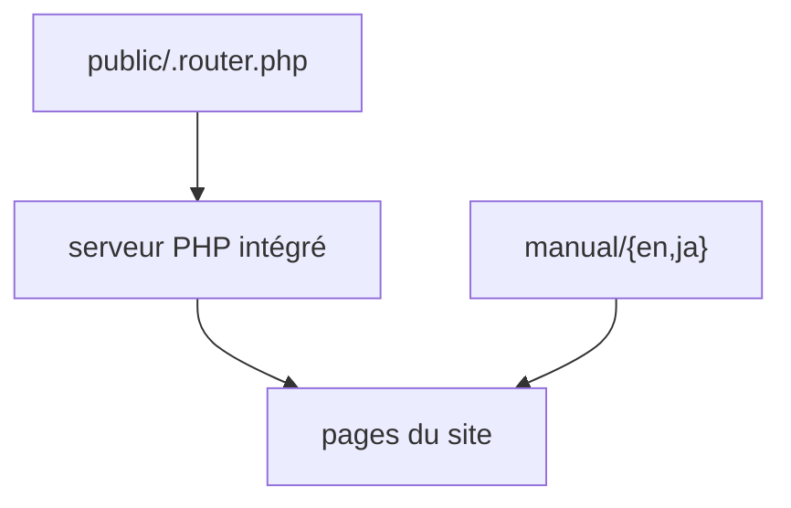

# php/web-php

> Code of the official php.net website, for contributors who want to host it or fix it locally.

## The problem
Contributing to the PHP website requires being able to run a local copy of it.

## What it actually does
The repository contains the php.net site and most of the generated files: news and events, a few manual pages (including one translation), user notes and a router for the built-in PHP server. The code must work on standard PHP 8.4. A full mirror is described on the PHP wiki.

## How it is wired
Simplified diagram based on the sheet, no diagram provided.



## Trying it
```bash
git clone https://github.com/php/web-php.git
cd web-php/public
php -S localhost:8080 .router.php
```

## Cost and gotchas
Free. PHP 8.4 required. No license is declared in the catalog.

## What it is not
Not the PHP language itself: only its website.

## Alternatives
No alternative named in the README.

## For you
Ignore: showcase site for a language, unrelated to your data / AI / MLOps work.
