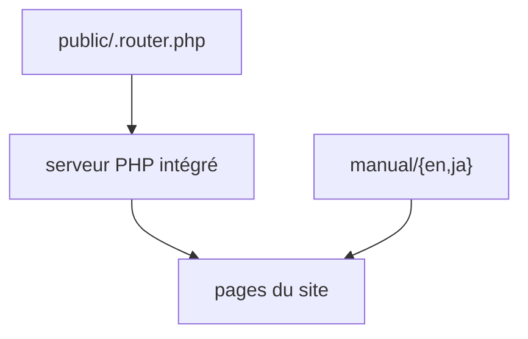

# php/web-php

> Code du site officiel php.net, pour contributeurs voulant l'héberger ou le corriger en local.

## Le problème
Contribuer au site de PHP suppose de pouvoir en lancer une copie locale.

## Ce que ça fait vraiment
Le dépôt contient le site php.net et la plupart des fichiers générés : actualités et événements, quelques pages du manuel (dont une traduction), notes utilisateur et un routeur pour le serveur PHP intégré. Le code doit fonctionner sur PHP 8.4 standard. Un miroir complet se décrit sur le wiki PHP.

## Comment c'est branché
Schéma simplifié d'après la fiche, sans diagramme fourni.



## Essayer
```bash
git clone https://github.com/php/web-php.git
cd web-php/public
php -S localhost:8080 .router.php
```

## Coût et pièges
Gratuit. PHP 8.4 requis. Aucune licence n'est déclarée dans le catalogue.

## Ce que ce n'est pas
Pas le langage PHP lui-même : seulement son site web.

## Alternatives
Aucune alternative nommée dans le README.

## Pour toi
Ignorer : site vitrine d'un langage, sans lien avec ton travail data / IA / MLOps.

