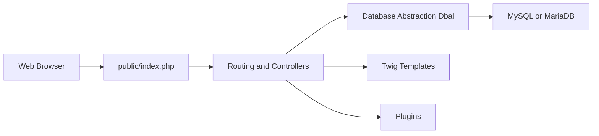

# phpmyadmin/phpmyadmin

> PHP web interface for administering MySQL and MariaDB databases from a browser.

## The problem
Administering a MySQL/MariaDB database on the command line is painful for non-specialists.

## What it actually does
Monolithic PHP application: entry point `public/index.php`, routing to controllers (`src/Controllers`), `src/Dbal` abstraction layer, Twig templates, import/export and authentication plugins, translations via Weblate. Composer manages dependencies.

## How it is wired

## Trying it
The README points to the website and the documentation. The only hint: with the Git version, run Composer by hand. No detailed command.

## Cost and gotchas
Free. Exposing the tool on the Internet is a classic risk; the README points to a security page. 958 open issues.

## What it is not
Not a data analysis or modeling tool. Does not handle PostgreSQL (README: MySQL and MariaDB).

## Alternatives
No alternative named in the README.

## For you
Worth watching: handy for occasionally inspecting a MySQL database, but outside the data/AI core; GPL-2.0 has no consequence for internal use.
