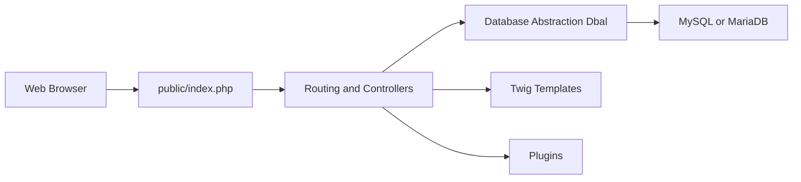

# phpmyadmin/phpmyadmin

> Interface web PHP pour administrer des bases MySQL et MariaDB depuis un navigateur.

## Le problème
Administrer une base MySQL/MariaDB en ligne de commande est pénible pour les non-spécialistes.

## Ce que ça fait vraiment
Application PHP monolithique : point d'entrée `public/index.php`, routage vers des contrôleurs (`src/Controllers`), couche d'abstraction `src/Dbal`, gabarits Twig, plugins d'import/export et d'authentification, traductions via Weblate. Composer gère les dépendances.

## Comment c'est branché

## Essayer
Le README renvoie au site et à la documentation. Seule indication : en version Git, lancer Composer à la main. Pas de commande détaillée.

## Coût et pièges
Gratuit. Exposer l'outil sur Internet est un risque classique ; le README renvoie vers une page sécurité. 958 issues ouvertes.

## Ce que ce n'est pas
Pas un outil d'analyse de données ni de modélisation. Ne gère pas PostgreSQL (README : MySQL et MariaDB).

## Alternatives
Aucune alternative nommée dans le README.

## Pour toi
À surveiller : pratique pour inspecter une base MySQL ponctuellement, mais hors du cœur data/IA ; GPL-2.0 sans conséquence pour un usage interne.

