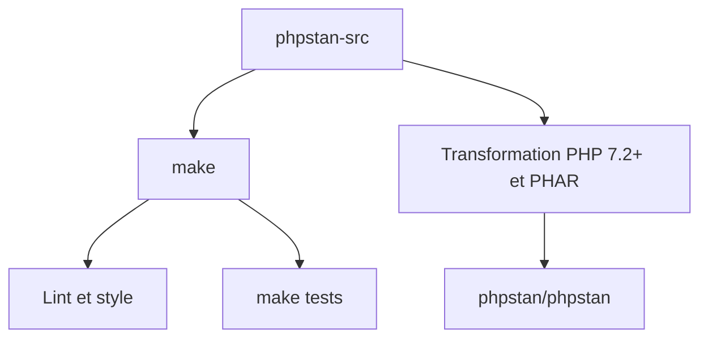

# phpstan/phpstan-src

> Development sources of PHPStan, the PHP static code analyzer, for its contributors.

## The problem
Static analysis for PHP is developed in a working repository separate from the distributed package.

## What it actually does
The README only covers development: `composer install`, `make` for the full build with lint and style checks, `make phpstan` to analyze itself, `make cs`, `make cs-fix` and `make tests`. The code is written for PHP 8.2 and then transformed to run on PHP 7.2 and above. The main README and the issues are in `phpstan/phpstan`.

## How it is wired
Simplified diagram based on the sheet, no diagram provided.


## Trying it
```bash
composer install
make
make phpstan
make cs-fix
make tests
```

## Cost and gotchas
Free. It requires PHP 8.2 and Composer (not in the prerequisites list); an old version of `patch` on macOS may fail, with `brew install gpatch` as the remedy.

## What it is not
It is not the package to install to analyze your code: that is `phpstan/phpstan`. It targets PHP, not Python.

## Alternatives
No alternative named in the README.

## For you
Ignore: contribution repository of a PHP tool, unrelated to your data / AI stack.
