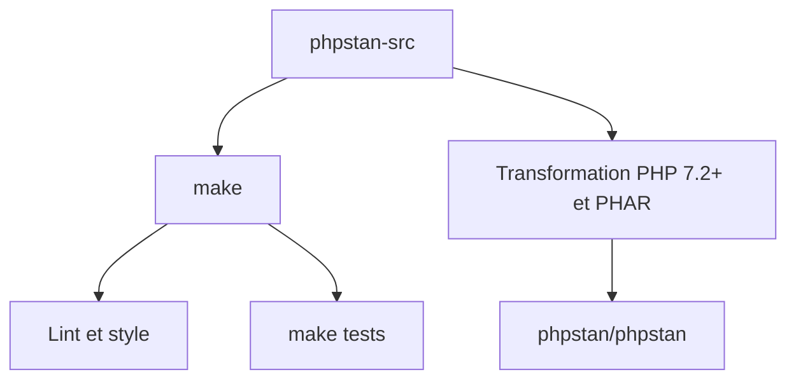

# phpstan/phpstan-src

> Sources de développement de PHPStan, l'analyseur statique de code PHP, pour ses contributeurs.

## Le problème
L'analyse statique de PHP se développe dans un dépôt de travail distinct du paquet distribué.

## Ce que ça fait vraiment
Le README ne décrit que le développement : `composer install`, `make` pour la construction complète avec lint et style, `make phpstan` pour s'analyser lui-même, `make cs`, `make cs-fix` et `make tests`. Le code est écrit pour PHP 8.2 puis transformé pour tourner sur PHP 7.2 et plus. Le README principal et les tickets sont dans `phpstan/phpstan`.

## Comment c'est branché
Schéma simplifié d'après la fiche, sans diagramme fourni.


## Essayer
```bash
composer install
make
make phpstan
make cs-fix
make tests
```

## Coût et pièges
Gratuit. Il faut PHP 8.2 et Composer (hors liste de prérequis) ; une version ancienne de `patch` sur macOS peut échouer, avec `brew install gpatch` en remède.

## Ce que ce n'est pas
Ce n'est pas le paquet à installer pour analyser ton code : c'est `phpstan/phpstan`. Il vise le PHP, pas Python.

## Alternatives
Aucune alternative nommée dans le README.

## Pour toi
À ignorer : dépôt de contribution d'un outil PHP, sans lien avec ta pile data / IA.

