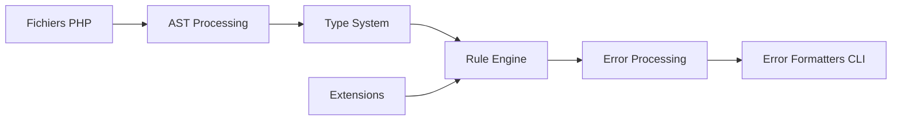

# phpstan/phpstan

> Static analyzer for PHP code that detects errors without running the code.

## The problem
Some PHP bugs only show up at runtime, even before you write tests.

## What it actually does
Analyzes the AST, applies a type system, a rule engine and extensions (dynamic return types, error formatters, PHPDoc types). NEON configuration, result cache, baseline, Composer integration. The `--pro` option adds a web interface and continuous analysis.

## How it is wired


## Trying it
```bash
phpstan analyse --pro
```
The `--pro` command is mentioned; installation is deferred to phpstan.org.

## Cost and gotchas
The core is free; PHPStan Pro is paid after 30 days (7 EUR per month for an individual, 70 EUR for a team of up to 25 members).

## What it is not
Not a testing tool nor a code formatter: it does not replace execution.

## Alternatives
No alternative named in the README.

## For you
Ignore: a PHP-only tool, unrelated to your data/AI work.
