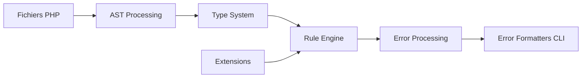

# phpstan/phpstan

> Analyseur statique de code PHP qui détecte des erreurs sans exécuter le code.

## Le problème
Des bogues PHP ne se révèlent qu'à l'exécution, avant même d'écrire les tests.

## Ce que ça fait vraiment
Analyse l'AST, applique un système de types, un moteur de règles et des extensions (types de retour dynamiques, formateurs d'erreurs, types PHPDoc). Configuration en NEON, cache de résultats, baseline, intégration Composer. L'option `--pro` ajoute une interface web et une analyse continue.

## Comment c'est branché


## Essayer
```bash
phpstan analyse --pro
```
Commande `--pro` mentionnée ; l'installation est renvoyée à phpstan.org.

## Coût et pièges
Le cœur est gratuit ; PHPStan Pro est payant après 30 jours (7 EUR par mois pour un individu, 70 EUR pour une équipe jusqu'à 25 membres).

## Ce que ce n'est pas
Pas un outil de tests ni un formateur de code : il ne remplace pas l'exécution.

## Alternatives
Aucune alternative nommée dans le README.

## Pour toi
Ignorer : outil réservé au PHP, sans lien avec ton travail data/IA.

