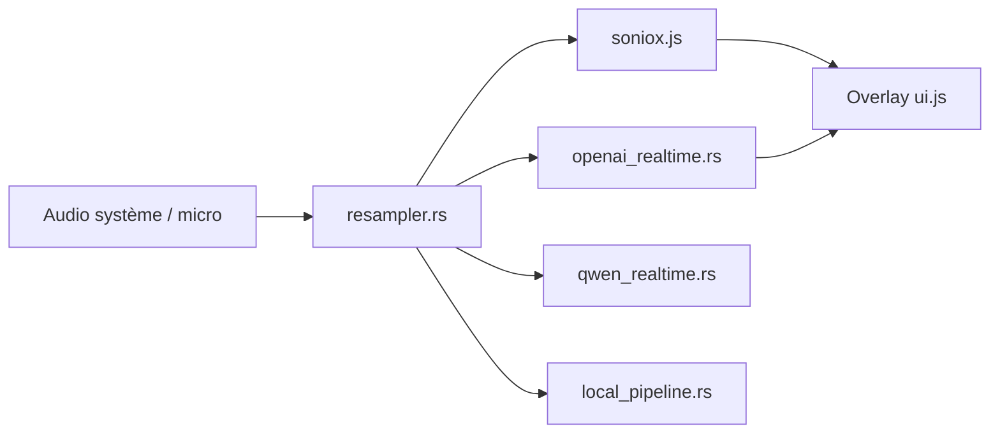

# phuc-nt/my-translator

> Tauri desktop application that translates system audio or microphone live, with no intermediate server.

## The problem
Following a meeting or a video in a foreign language requires real-time subtitles, not a service that goes through a third-party relay.

## What it actually does
Captures system audio (ScreenCaptureKit, WASAPI) and the microphone, resamples to 16 kHz and sends it to the chosen engine: Soniox, OpenAI Realtime, Qwen LiveTranslate or a local MLX mode (Apple Silicon, experimental). Displays the translation as an overlay, bidirectional translation, optional speech synthesis (Edge, Google, ElevenLabs), transcripts in `.md`.

## How it is wired


## Trying it
```bash
git clone https://github.com/phuc-nt/my-translator.git
cd my-translator
npm install
npm run tauri build
```
Or download the .dmg / .exe from the releases.

## Cost and gotchas
Keys are at your expense: ~$0.12/h (Soniox), ~$4/h (OpenAI), free Qwen preview. Local mode: Apple Silicon only, latency ~10 s.

## What it is not
Not offline by default: only the MLX mode is. No Linux version.

## Alternatives
No alternative cited in the README.

## For you
Worth watching: a good example of a real-time translation pipeline with several engines; useful for meetings, with no direct link to your MLOps work.
