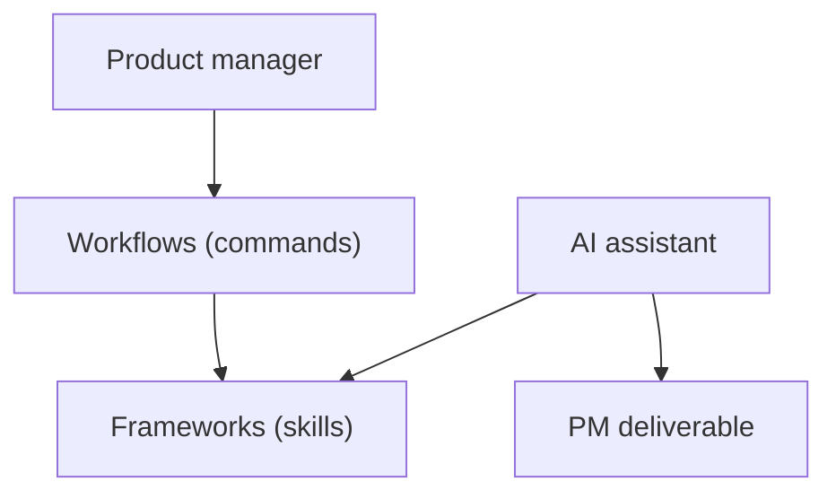

# phuryn/pm-skills

> Marketplace of product management skills and commands for Claude Code, Cowork and other assistants.

## The problem
Assistants produce text without a framework: discovery, strategy or PRDs without a recognized method.

## What it actually does
Nine plugins (discovery, strategy, execution, market research, analytics, go-to-market, growth, toolkit, AI shipping). Each skill encodes a framework (OST, RICE, Lean Canvas...), and commands such as `/discover`, `/write-prd` etc. chain skills together. The AI shipping plugin has moved to phuryn/product-engineering. Under Codex, slash commands do not run.

## How it is wired


## Trying it
```bash
claude plugin marketplace add phuryn/pm-skills
claude plugin install pm-toolkit@pm-skills
claude plugin install pm-execution@pm-skills
```

## Cost and gotchas
Free; consumes your assistant's tokens. Install whole plugins, not individual skills.

## What it is not
Not application code: structured prompts. The commands are specific to Claude Code. Output quality depends on the model.

## Alternatives
- phuryn/product-engineering: the relocated ai-shipping plugin.

## For you
Keep an eye on it: little relevance to data/ML except the analytics plugin (SQL, A/B testing); useful if you frame AI products.
