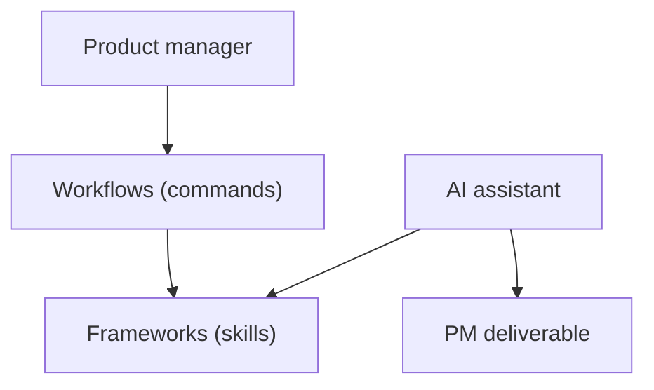

# phuryn/pm-skills

> Marketplace de skills et commandes de product management pour Claude Code, Cowork et autres assistants.

## Le problème
Les assistants produisent du texte sans cadre : discovery, stratégie ou PRD sans méthode reconnue.

## Ce que ça fait vraiment
Neuf plugins (discovery, stratégie, exécution, recherche marché, analytics, go-to-market, growth, toolkit, AI shipping). Chaque skill encode un cadre (OST, RICE, Lean Canvas...), les commandes `/discover`, `/write-prd` etc. enchaînent des skills. Le plugin AI shipping a déménagé vers phuryn/product-engineering. Sous Codex, les slash commands ne tournent pas.

## Comment c'est branché


## Essayer
```bash
claude plugin marketplace add phuryn/pm-skills
claude plugin install pm-toolkit@pm-skills
claude plugin install pm-execution@pm-skills
```

## Coût et pièges
Gratuit ; consomme les tokens de ton assistant. Installer les plugins entiers, pas des skills isolés.

## Ce que ce n'est pas
Pas du code applicatif : des prompts structurés. Les commandes sont propres à Claude Code. La qualité des sorties dépend du modèle.

## Alternatives
- phuryn/product-engineering : le plugin ai-shipping déplacé.

## Pour toi
À surveiller : peu de rapport avec la data/ML sauf le plugin analytics (SQL, A/B test) ; utile si tu cadres des produits IA.

