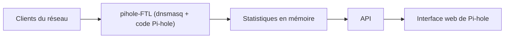

# pi-hole/FTL

> Pi-hole's DNS engine, an enriched dnsmasq that provides statistics and an API for ad blocking.

## The problem
Blocking ads network-wide requires a DNS server that exposes its statistics to Pi-hole's web interface.

## What it actually does
FTLDNS (pihole-FTL) is dnsmasq plus Pi-hole's code. It reads statistics directly in memory, provides an interactive API and can quickly pick up dnsmasq changes. It targets modest hardware (Raspberry Pi Zero). It is installed along with Pi-hole.

## How it is wired
Simplified diagram based on the sheet, no diagram provided.



## Trying it
```bash
# Aucune commande dans le README :
# FTLDNS s'installe automatiquement avec Pi-hole
```

## Cost and gotchas
Free. FTLDNS disables any existing dnsmasq installation, since the two cannot run together. You need Linux hardware.

## What it is not
Not a standalone product: it lives inside Pi-hole. The README gives neither a separate installation procedure nor API details. The license is present but unidentified.

## Alternatives
No alternative cited in the README.

## For you
Ignore: a DNS blocking building block for your home network, of no interest for data, AI or MLOps pipelines.
