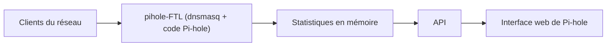

# pi-hole/FTL

> Moteur DNS de Pi-hole, un dnsmasq enrichi qui fournit statistiques et API pour le blocage de publicités.

## Le problème
Bloquer les publicités à l'échelle du réseau demande un serveur DNS qui expose ses statistiques à l'interface web de Pi-hole.

## Ce que ça fait vraiment
FTLDNS (pihole-FTL) est dnsmasq plus le code de Pi-hole. Il lit les statistiques directement en mémoire, fournit une API interactive et peut intégrer rapidement les évolutions de dnsmasq. Il vise le matériel modeste (Raspberry Pi Zero). Il s'installe avec Pi-hole.

## Comment c'est branché
Schéma simplifié d'après la fiche, sans diagramme fourni.



## Essayer
```bash
# Aucune commande dans le README :
# FTLDNS s'installe automatiquement avec Pi-hole
```

## Coût et pièges
Gratuit. FTLDNS désactive toute installation dnsmasq existante, car les deux ne peuvent pas tourner ensemble. Il faut du matériel Linux.

## Ce que ce n'est pas
Pas un produit autonome : il vit dans Pi-hole. Le README ne donne ni procédure d'installation séparée ni détails de l'API. La licence est présente mais non identifiée.

## Alternatives
Aucune alternative citée dans le README.

## Pour toi
À ignorer : brique de blocage DNS pour ton réseau domestique, sans intérêt pour des pipelines data, IA ou MLOps.

