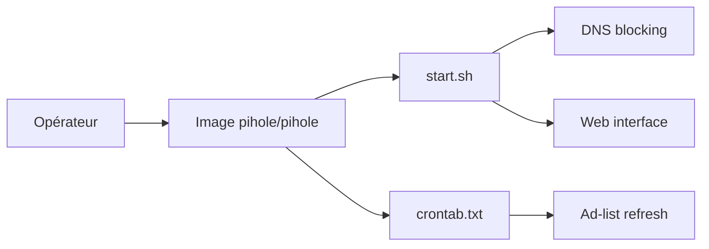

# pi-hole/docker-pi-hole

> Docker image of Pi-hole: DNS-level ad blocking for a whole network.

## The problem
Blocking ads and trackers device by device is tedious; the goal is to do it once at the network level.

## What it actually does
A container that exposes DNS (53), the web interface (80/443) and, optionally, DHCP and NTP. A built-in cron job refreshes the blocklists and flushes the logs. Settings are made through `FTLCONF_*` variables and an `/etc/pihole` volume. Tags: `latest`, dated, `nightly`.

## How it is wired


## Trying it
```bash
docker compose up -d
```
(after copying the compose file from the README: ports 53/80/443, volume `./etc-pihole:/etc/pihole`)

## Cost and gotchas
Free. Avoid `--privileged`; grant only the useful capabilities (`NET_ADMIN` for DHCP). Random password if none is set.

## What it is not
Not a firewall: it filters DNS queries. Clients that do not use this DNS are not protected.

## Alternatives
No alternative named in the README.

## For you
Worth watching if you build a home lab: simple to deploy, but with no direct link to data/AI.
