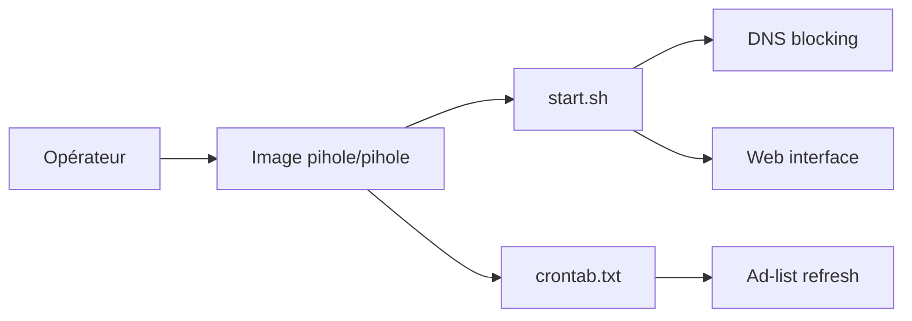

# pi-hole/docker-pi-hole

> Image Docker de Pi-hole : blocage de publicité au niveau DNS pour tout un réseau.

## Le problème
Bloquer pubs et traqueurs poste par poste est fastidieux ; on veut le faire une fois au niveau réseau.

## Ce que ça fait vraiment
Conteneur qui expose DNS (53), interface web (80/443) et, en option, DHCP et NTP. Une tâche cron intégrée rafraîchit les listes de blocage et vide les journaux. Les réglages se passent par variables `FTLCONF_*` et un volume `/etc/pihole`. Tags : `latest`, datés, `nightly`.

## Comment c'est branché


## Essayer
```bash
docker compose up -d
```
(après avoir copié le fichier compose du README : ports 53/80/443, volume `./etc-pihole:/etc/pihole`)

## Coût et pièges
Gratuit. Éviter `--privileged` ; accorder seulement les capacités utiles (`NET_ADMIN` pour DHCP). Mot de passe aléatoire si non fixé.

## Ce que ce n'est pas
Pas un pare-feu : il filtre les requêtes DNS. Les clients qui n'utilisent pas ce DNS ne sont pas protégés.

## Alternatives
Aucune alternative nommée dans le README.

## Pour toi
À surveiller si tu monte un labo maison : simple à déployer, mais sans lien direct avec data/IA.

