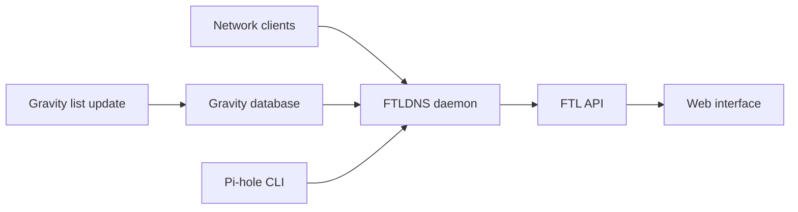

# pi-hole/pi-hole

> Network-level ad-blocking solution via DNS, installable on Linux hardware.

## The problem
These ads and trackers target mobile apps and televisions, where browser extensions cannot be installed.

## What it actually does
This repository contains the installation and administration shell layer; DNS and statistics are provided by the separate FTLDNS daemon. The router is configured to point to Pi-hole, the blocklist is updated (using Gravity), and a command-line interface, a web interface, and an API expose the statistics. It can also function as a DHCP server.

## How it is wired


## Trying it
```bash
curl -sSL https://install.pi-hole.net | bash
git clone --depth 1 https://github.com/pi-hole/pi-hole.git Pi-hole
cd "Pi-hole/automated install/" && sudo bash basic-install.sh
```

## Cost and gotchas
Free to use. Users need to configure their router to use Pi-hole as the DNS server, or to enable its DHCP functionality while disabling the router's DHCP. The README acknowledges that the `curl | bash` method is controversial.

## What it is not
It's not a firewall or a VPN; it blocks domain names. The license is not identified by GitHub.

## Alternatives
No alternative is specified in the README file.

## For you
Not suitable for daily data/AI monitoring: intended for home or small business networks.
