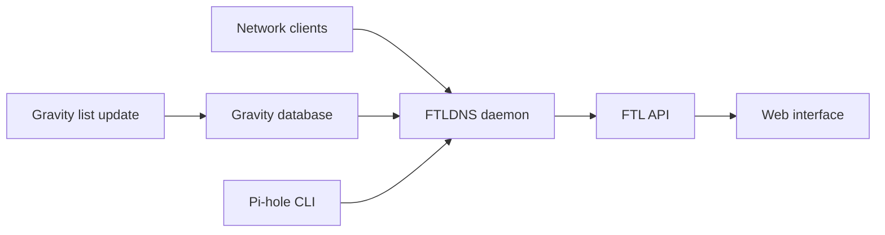

# pi-hole/pi-hole

> Bloqueur de publicités au niveau du réseau via DNS, installable sur du matériel Linux.

## Le problème
Les publicités et traceurs touchent des applications mobiles et téléviseurs où l'on ne peut pas installer d'extension de navigateur.

## Ce que ça fait vraiment
Ce dépôt est la couche shell d'installation et d'administration ; le DNS et les statistiques sont fournis par le démon séparé FTLDNS. On pointe le routeur vers Pi-hole, la liste de blocage est mise à jour (gravity), et un CLI, une interface web et une API exposent les statistiques. Peut aussi servir de DHCP.

## Comment c'est branché


## Essayer
```bash
curl -sSL https://install.pi-hole.net | bash
git clone --depth 1 https://github.com/pi-hole/pi-hole.git Pi-hole
cd "Pi-hole/automated install/" && sudo bash basic-install.sh
```

## Coût et pièges
Gratuit. Il faut configurer le routeur pour que les clients utilisent Pi-hole comme DNS, ou activer son DHCP en désactivant celui du routeur. Le README reconnaît que le `curl | bash` est controversé.

## Ce que ce n'est pas
Pas un pare-feu ni un VPN : il bloque des noms de domaine. La licence n'est pas identifiée par GitHub.

## Alternatives
Aucune alternative nommée dans le README.

## Pour toi
À ignorer pour la veille data / IA : outil de réseau domestique ou de petite structure.

