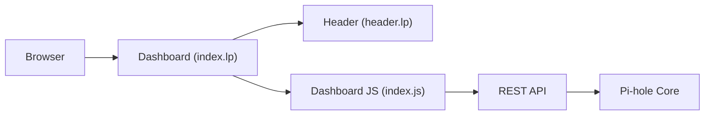

# pi-hole/web

> Web administration interface of Pi-hole, the network ad blocker, for managing DNS.

## The problem
Configuring a blocking DNS and reading its statistics without going through the command line.

## What it actually does
Server-side rendered Lua pages (`.lp`) with per-page JavaScript: dashboard, query log, live logs, groups and allow/block lists, DNS/DHCP/privacy settings, Teleporter (export/import), domain search. Relies on Pi-hole's `/api` REST API (documentation at `/api/docs`). Multiple themes, AdminLTE base.

## How it is wired

## Trying it
The README gives no command; the interface is enabled when Pi-hole is installed and is reachable at `https://pi.hole/admin/`.

## Cost and gotchas
Free. Requires a Pi-hole installation. License not identified by GitHub: to be checked.

## What it is not
Not a standalone project: without Pi-hole and FTLDNS it is useless.

## Alternatives
No alternative named in the README.

## For you
Ignore for data/AI watch: a component of a home network tool, useful only if you already run a Pi-hole.
