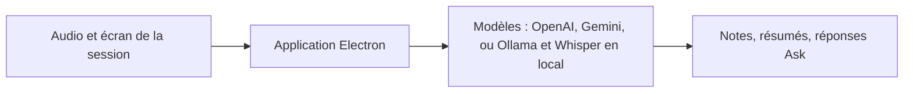

# pickle-com/glass

> Desktop assistant that sees the screen and listens to meetings to produce summaries and answers in real time.

## The problem
During a meeting, you lose the action items to remember and the context of what was said or shown on screen.

## What it actually does
- Live meeting notes, summaries and session recordings.
- "Ask" feature: questions to the AI backed by screen and audio history (`Ctrl/Cmd + Enter`).
- Models via OpenAI, Gemini, or Ollama and Whisper locally; personal key or service account.
- Fork of CheatingDaddy; Electron desktop application.

## How it is wired
Simplified diagram based on the sheet, no diagram provided.

No diagram or code architecture provided: the internal workings are not documented here.

## Trying it
```bash
node --version   # Node 20.x.x requis
npm run setup
```
Or download the macOS .dmg linked in the README (hosted on Dropbox).

## Cost and gotchas
OpenAI or Gemini key at your expense, or a free Pickle account; on Windows, Build Tools for Visual Studio. Node 20.x required for native dependencies.

## What it is not
Not verifiably "invisible": the README claims it (absent from screenshots and recordings) without demonstrating it, and it raises consent questions in meetings. Not active: last push in October 2025, 113 open issues. GPL-3.0 license: copyleft.

## Alternatives
No alternative named; CheatingDaddy is the project it is a fork of.

## For you
Ignore: inactive for over a year, GPL-3.0, and permanent screen and audio capture that poses a privacy risk with no clear benefit for your work.
