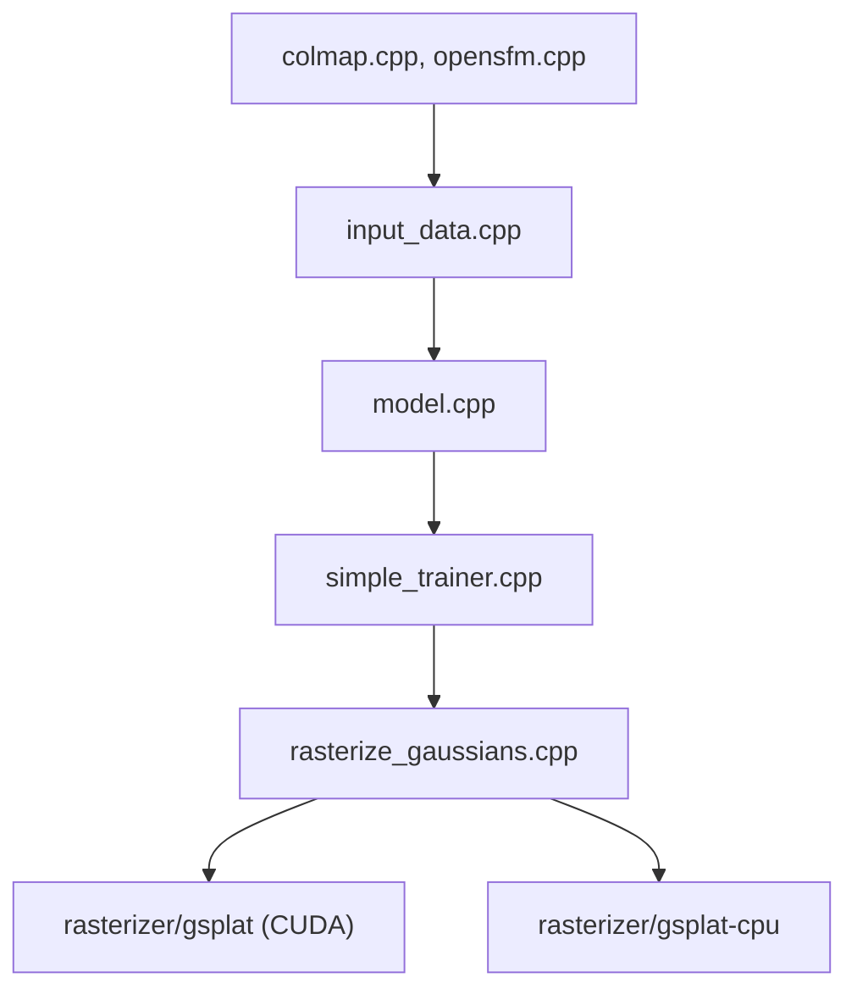

# pierotofy/OpenSplat

> Free C++ implementation of 3D gaussian splatting, for turning photogrammetry reconstructions into scenes.

## The problem
Training a gaussian splatting scene often requires CUDA-bound tools or a heavy Python ecosystem.

## What it actually does
Reads COLMAP, OpenSfM, OpenMVG, ODX or nerfstudio projects with sparse points, optimizes a gaussian model (L1 + DSSIM loss) and exports .ply, .splat, .spz or .rad. CUDA, ROCm/HIP, Metal and CPU rasterizers (about 100 times slower). Training resume, image masks, camera export. About 2 GB of GPU per million gaussians.

## How it is wired


## Trying it
```bash
git clone https://github.com/pierotofy/OpenSplat OpenSplat
cd OpenSplat
mkdir build && cd build
cmake -DCMAKE_PREFIX_PATH=/path/to/libtorch/ .. && make -j$(nproc)
./opensplat /path/to/banana -n 2000
```

## Cost and gotchas
Free (a prebuilt Windows version is paid, to support the project). Requires libtorch and OpenCV, ideally CUDA, ROCm or Metal. AGPL-3.0 license: sharing obligations if offered as a network service. Random initialization is not supported: sparse points are required.

## What it is not
Not a photogrammetry tool: it starts from an already-made reconstruction. No built-in viewer.

## Alternatives
No alternative named in the README (splatfacto cited as the methodological basis).

## For you
Worth watching if you work on 3D vision: portable C++/libtorch, but a niche use and the AGPL license must be weighed.
