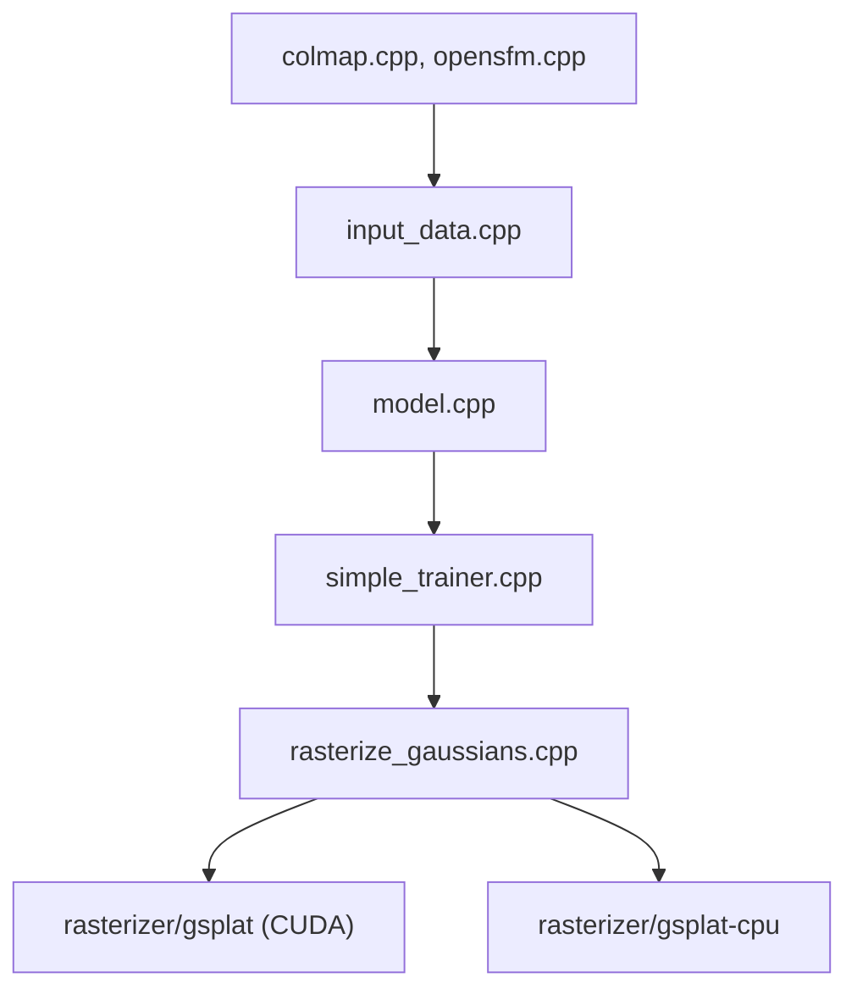

# pierotofy/OpenSplat

> Implémentation C++ libre du gaussian splatting 3D, pour transformer des reconstructions photogrammétriques en scènes.

## Le problème
Entraîner une scène de gaussian splatting demande souvent des outils liés à CUDA ou à un écosystème Python lourd.

## Ce que ça fait vraiment
Lit des projets COLMAP, OpenSfM, OpenMVG, ODX ou nerfstudio avec points épars, optimise un modèle de gaussiennes (perte L1 + DSSIM) et exporte .ply, .splat, .spz ou .rad. Rasteriseurs CUDA, ROCm/HIP, Metal et CPU (environ 100 fois plus lent). Reprise d'entraînement, masques d'images, export des caméras. Environ 2 Go de GPU par million de gaussiennes.

## Comment c'est branché


## Essayer
```bash
git clone https://github.com/pierotofy/OpenSplat OpenSplat
cd OpenSplat
mkdir build && cd build
cmake -DCMAKE_PREFIX_PATH=/path/to/libtorch/ .. && make -j$(nproc)
./opensplat /path/to/banana -n 2000
```

## Coût et pièges
Gratuit (version Windows précompilée payante pour soutenir le projet). Exige libtorch et OpenCV, idéalement CUDA, ROCm ou Metal. Licence AGPL-3.0 : obligations de partage en cas de service réseau. L'initialisation aléatoire n'est pas supportée : il faut des points épars.

## Ce que ce n'est pas
Pas un outil de photogrammétrie : il part d'une reconstruction déjà faite. Pas de visionneuse intégrée.

## Alternatives
Aucune alternative nommée dans le README (splatfacto cité comme base méthodologique).

## Pour toi
À surveiller si tu touches à la vision 3D : C++/libtorch portable, mais usage de niche et licence AGPL à peser.

