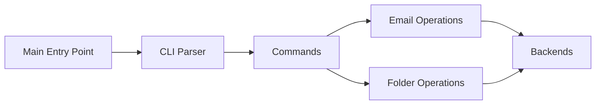

# pimalaya/himalaya

> Command-line email client, scriptable, with an MCP server that is read-only by default.

## The problem
Reading and sorting email from scripts or an agent means fiddling with IMAP, SMTP and the Gmail or Microsoft APIs one by one.

## What it actually does
A common API (mailboxes, envelopes, flags, messages, attachments) covers IMAP, SMTP, JMAP, Gmail, Microsoft Graph, Maildir and ManageSieve. JSON output, REPL mode and multi-protocol search. `himalaya mcp` exposes these functions as tools for an agent.

## How it is wired


## Trying it
```bash
curl -sSL https://raw.githubusercontent.com/pimalaya/himalaya/master/install.sh | PREFIX=~/.local sh
himalaya
himalaya envelope list --page 2
himalaya envelope search from alice and after 2026-01-01 order by date desc
himalaya mcp --account work
```

## Cost and gotchas
Free, but you need an email account and often an app password or an OAuth token. No built-in OAuth flow: the token must be supplied by a third-party tool.

## What it is not
Not a full-screen interface like mutt or aerc. The README warns that an agent reading mail can be pushed into sending some: do not grant write and send rights together.

## Alternatives
- aerc, mutt, alpine: interactive terminal interfaces.
- pimalaya/himalaya-tui: TUI version of the same project.

## For you
Worth watching: a useful building block for giving an agent read-only email access, once permissions are scoped.
