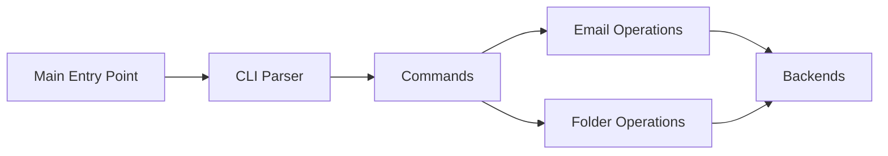

# pimalaya/himalaya

> Client de messagerie en ligne de commande, scriptable, avec serveur MCP en lecture seule par défaut.

## Le problème
Lire et trier ses courriels depuis des scripts ou un agent exige de bricoler IMAP, SMTP et les API Gmail ou Microsoft une par une.

## Ce que ça fait vraiment
Une API commune (boîtes, enveloppes, drapeaux, messages, pièces jointes) couvre IMAP, SMTP, JMAP, Gmail, Microsoft Graph, Maildir et ManageSieve. Sortie JSON, mode REPL et recherche multi-protocole. `himalaya mcp` expose ces fonctions comme outils pour un agent.

## Comment c'est branché


## Essayer
```bash
curl -sSL https://raw.githubusercontent.com/pimalaya/himalaya/master/install.sh | PREFIX=~/.local sh
himalaya
himalaya envelope list --page 2
himalaya envelope search from alice and after 2026-01-01 order by date desc
himalaya mcp --account work
```

## Coût et pièges
Gratuit, mais il faut un compte courriel et souvent un mot de passe d'application ou un jeton OAuth. Aucun flux OAuth intégré : jeton à fournir par un outil tiers.

## Ce que ce n'est pas
Ce n'est pas une interface plein écran comme mutt ou aerc. Le README avertit qu'un agent qui lit du courrier peut être poussé à en envoyer : ne pas donner les droits d'écriture et d'envoi ensemble.

## Alternatives
- aerc, mutt, alpine : interfaces en terminal interactives.
- pimalaya/himalaya-tui : version TUI du même projet.

## Pour toi
À surveiller : brique utile pour donner à un agent un accès courriel en lecture seule, après avoir cadré les droits.

