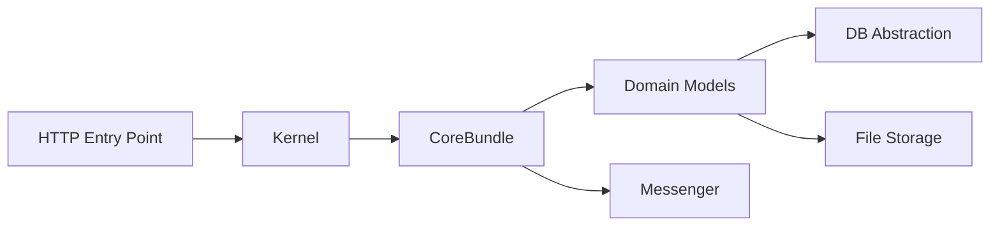

# pimcore/pimcore

> An open core product experience management platform (PIM, MDM, DAM, CMS), built on Symfony.

## The problem
Product data, media and content are scattered across tools, with no single source to feed sites and channels.

## What it actually does
Three types of linked elements: data objects (models defined in an editor), assets (DAM) and documents (CMS, Twig). Delivery is rendered server-side or headless via REST and GraphQL (Datahub). PHP and Symfony backend, React Studio interface, MySQL or MariaDB, OpenSearch, Redis, Mercure.

## How it is wired

## Trying it
No command in the README: Docker installation is described in the online guide.

## Cost and gotchas
Pimcore Open Core License (POCL): "present but unidentified" according to GitHub. Modules depend on the editions (Community, Professional, Enterprise, PaaS). Docker is mandatory locally. Public issues are centralized in `pimcore/platform-version`.

## What it is not
Not a simple CMS nor fully free: some modules are reserved for commercial editions. Not a data/AI tool, despite "Copilot" in the list of modules.

## Alternatives
No alternative named in the README.

## For you
Ignore: an e-commerce product management platform, outside your profile, with a custom license to reread.
