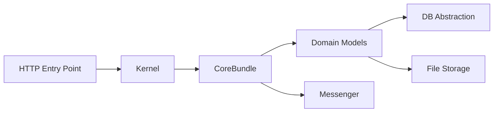

# pimcore/pimcore

> Plateforme open core de gestion de l'expérience produit (PIM, MDM, DAM, CMS), construite sur Symfony.

## Le problème
Les données produit, les médias et le contenu sont dispersés entre outils, sans source unique pour alimenter sites et canaux.

## Ce que ça fait vraiment
Trois types d'éléments liés : objets de données (modèles définis dans un éditeur), assets (DAM) et documents (CMS, Twig). Livraison rendue côté serveur ou headless via REST et GraphQL (Datahub). Backend PHP et Symfony, interface Studio en React, MySQL ou MariaDB, OpenSearch, Redis, Mercure.

## Comment c'est branché

## Essayer
Aucune commande dans le README : installation Docker décrite dans le guide en ligne.

## Coût et pièges
Licence Pimcore Open Core License (POCL) : « présente mais non identifiée » par GitHub. Modules selon les éditions (Community, Professional, Enterprise, PaaS). Docker obligatoire en local. Issues publiques centralisées dans `pimcore/platform-version`.

## Ce que ce n'est pas
Pas un simple CMS ni entièrement libre : certains modules sont réservés à des éditions commerciales. Pas un outil data/IA, malgré « Copilot » dans la liste des modules.

## Alternatives
Aucune alternative nommée dans le README.

## Pour toi
Ignorer : plateforme de gestion produit e-commerce, hors profil, avec une licence maison à relire.

