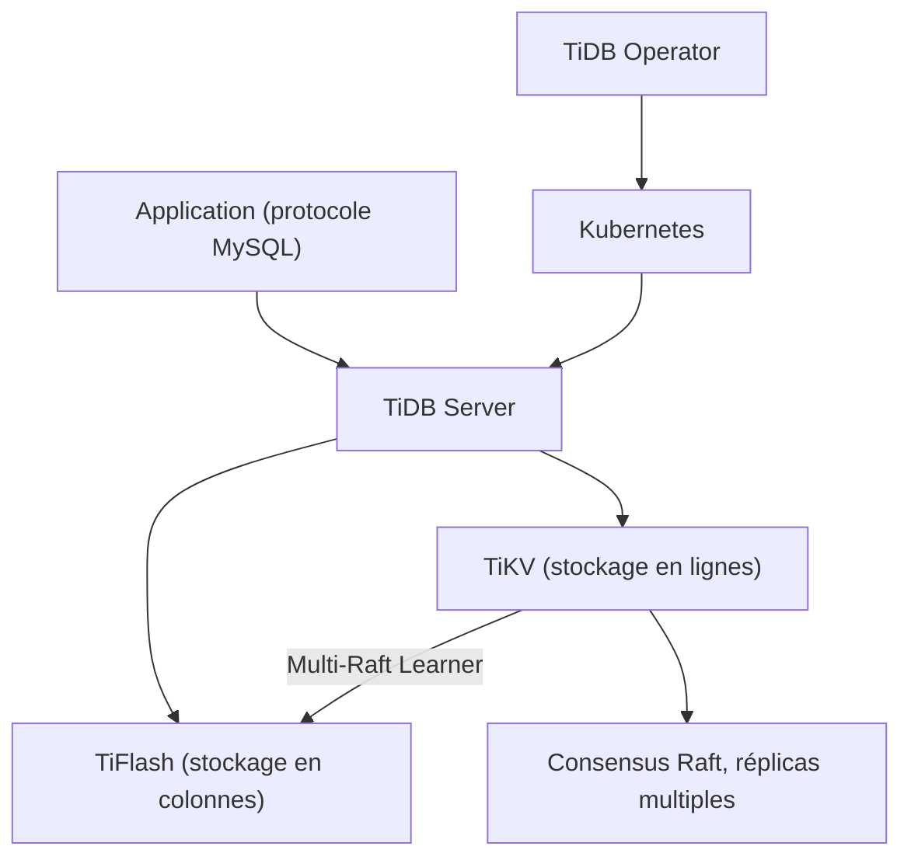

# pingcap/tidb

> MySQL 8.0-compatible distributed SQL database, both transactional and analytical.

## The problem
Past a certain size, MySQL forces application-level sharding, and analytics requires a
second database fed by ETL, with the data drift that comes with it.

## What it actually does
Provides ACID distributed transactions through two-phase commit, including during
network partitions or node failures.
Separates compute and storage, which allows adding nodes without downtime, horizontally
or vertically. Replication relies on Raft: a transaction is committed only after
being written to the majority of replicas, and the geographic placement of replicas is configurable.
Provides two engines: TiKV (row-based) and TiFlash (columnar), with TiFlash replicating TiKV in real time
via Multi-Raft Learner; the TiDB server coordinates queries across both (HTAP).

## How it is wired


## Trying it
```bash
# Aucune commande dans le README : il renvoie au guide de démarrage rapide,
# à TiDB Operator pour Kubernetes, ou à l'inscription TiDB Cloud.
```

## Cost and gotchas
The code is under Apache 2.0, enterprise features included. TiDB Cloud, PingCAP's managed
service, is the "recommended" route in the README, with a free tier. Self-hosted,
a TiDB + TiKV + TiFlash + PD cluster requires machines and operations work.

## What it is not
It is not a transparent drop-in MySQL replacement for every case: the README speaks of migration
"with no code changes or minimal modifications". It is not a pure analytical database:
TiFlash complements TiKV, it does not replace it.

## Alternatives
No alternative named in the README.

## For you
Relevant if your dashboards and your application are fighting over the same production database.
